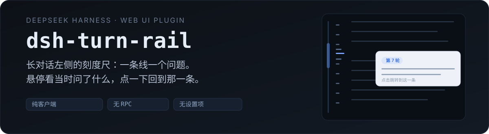
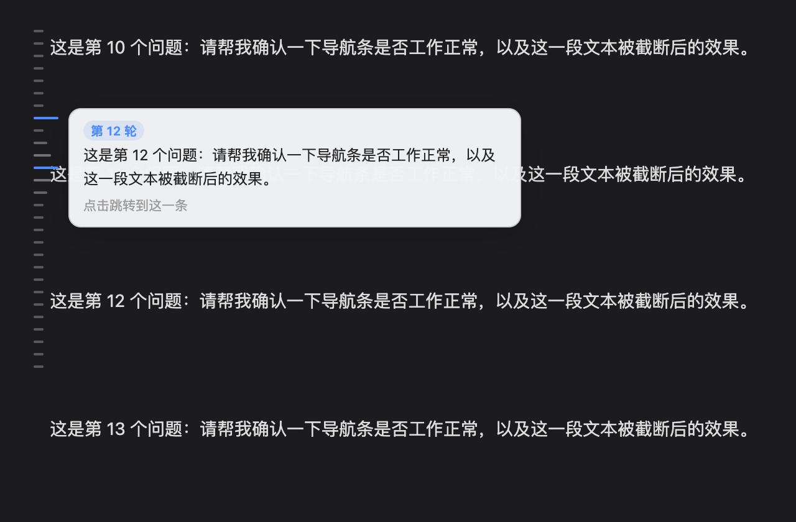
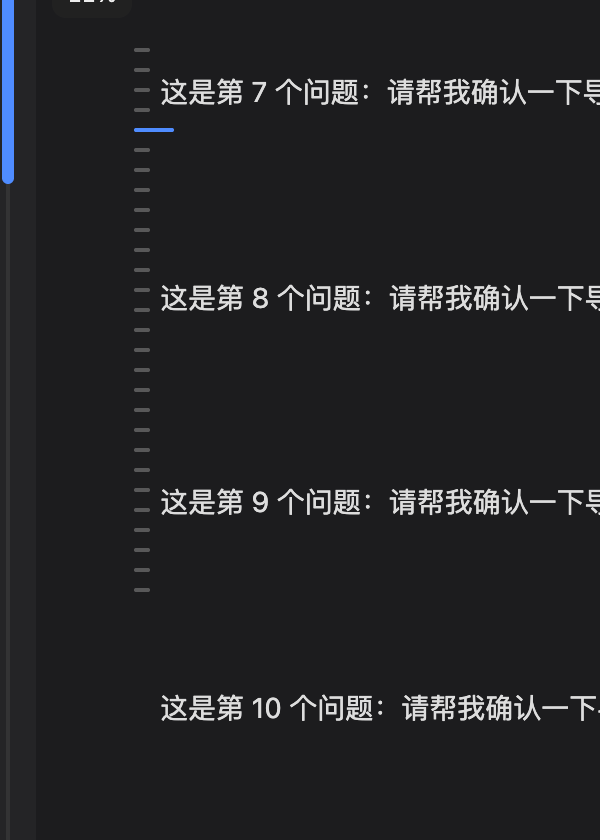

<p align="center">
  
</p>

<p align="center">
  <a href="#安装"></a>
  
  
  
</p>

<p align="center">
  <b>对话长了以后，回到「某一个问题的位置」不该靠运气。</b><br>
  一列刻度，悬停看当时问了什么，点一下跳过去。
</p>

<p align="center">
  <a href="./README.en.md">English</a> · <b>中文</b>
</p>

## 先看效果

<p align="center">
  
</p>

<p align="center">
  <sub>悬停任意刻度 → 变长、上下相邻两根略长；卡片显示轮次与提问原文。</sub>
</p>

<p align="center">
  
</p>

<p align="center">
  <sub>最左侧细进度条：拖拽或点击按比例跳转。</sub>
</p>

## 它解决什么

长会话里，`Ctrl+F` 是找词，不是找位置。想回到三步之前那个问题，只能一路往上滚，或者反复点「加载更早」翻到眼熟为止。

**dsh-turn-rail** 在对话区左缘放一列短横线：**一条线 = 你发出的一个问题**。悬停看到当时问了什么，点击直接过去。它只做这一件事——不加设置项，不加面板，不加后台任务。

### 四个细节

| | |
|---|---|
| **目标不在当前页也能跳** | 历史是虚拟列表，翻走了的节点不在 DOM 里。点击时它会驱动宿主自己的「加载更早」把那一页翻回来，再定位过去（预算 6 秒，按钮消失即认定历史到头） |
| **同一句话发两次也不会跳错** | 定位用的是消息锚点 `data-chat-anchor-key`，不是文本匹配 |
| **知道你在哪** | 你正在看的那一轮始终是蓝色长刻度，随滚动实时移动 |
| **不挡字** | 刻度压到正文时自动向左让位（最多 14px），退无可退才隐藏 |

## 安装

```sh
dsh plugin --profile web add https://github.com/shrekcg/dsh-turn-rail
```

装完 **硬刷新浏览器**（Cmd/Ctrl + Shift + R）。

> `web` 换成你自己的 profile 名，桌面版通常是 `desktop`。

## 为什么它这么轻

这个插件的核心约束是**不被宿主替掉**。

DSH 里做同类功能的插件大多走「客户端 `inject: [..., 'remote']` → RPC 读会话日志」这条路。0.2.x 的客户端 API 换过一轮，那条路整体失效——表现是插件装好了、页面上什么都没有。

`dsh-turn-rail` 只依赖两样在 UI 层长期稳定的东西：

```text
[data-conversation-scroll]                  对话滚动视口
[data-chat-flow-kind="user"|"steering"]     你发出的提问节点
```

分页复用宿主自己的「加载更早」按钮，不自己读日志、不自己发请求。没有宿主服务依赖、没有后台进程、没有设置面板、没有任何存储。

## 边界

- 只在 Web GUI 的「对话」视图渲染，切到轨迹 / 子代理视图自动隐藏。
- 被宿主压缩（compaction）掉的历史不在 DOM 里，刻度也不会包含——不伪造历史。
- 若宿主未来改动上面两个 DOM 契约，刻度会整体不显示（安静失败，不影响对话）。修复点集中在 [`lib/client.js`](./lib/client.js) 顶部的 `SEL` 常量。

## 项目结构

```text
dsh-turn-rail/
├── package.json          # dsh.bundle + dsh.client 清单
├── cordis.patch.yml      # 挂载到 profile 的一行
├── index.js              # 宿主端：空实现（滑轨完全在浏览器侧）
├── lib/client.js         # 全部逻辑：样式、布局、悬停、跳转、进度
└── assets/readme/        # 封面与截图
```

没有构建步骤：`lib/client.js` 就是最终产物（`__ModuleLoader__.load` bundle 格式）。

```sh
git clone https://github.com/shrekcg/dsh-turn-rail
dsh plugin --profile web add link:./dsh-turn-rail
# 改 lib/client.js，重启 DSH 即生效
```

## License

[MIT](./LICENSE) © 2026 shrek wu · English version: [`README.en.md`](./README.en.md)
