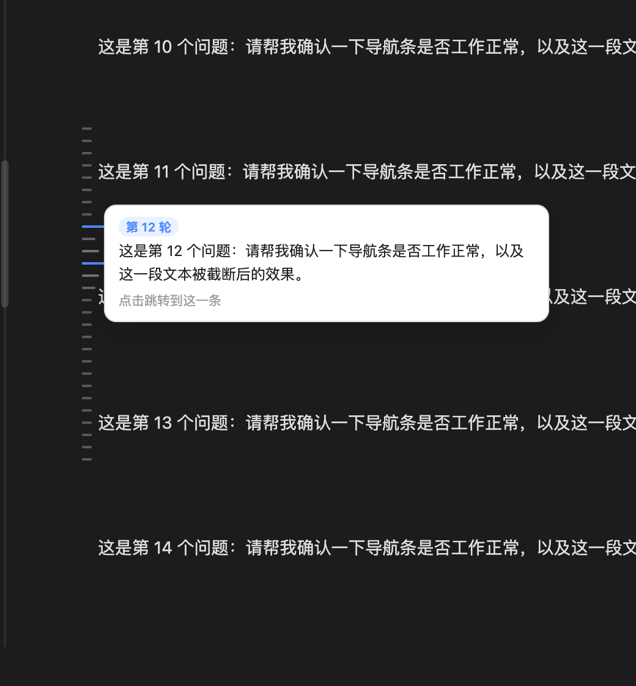
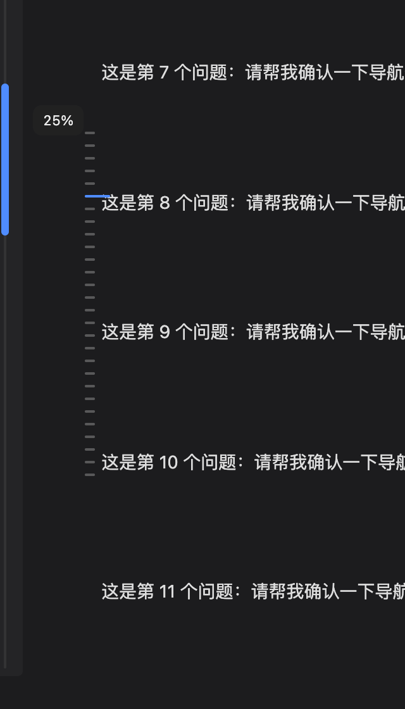

# dsh-turn-rail

<p align="center">
  
</p>

<p align="center">
  <strong>给长对话一条刻度尺：悬停看提问，点一下到那一条。</strong><br>
  纯客户端插件，不读会话日志、不走 RPC、不加任何设置项。
</p>

English | [中文](./README.zh.md)

## 为什么需要它

对话长了以后，想回到某一个问题的位置，只能一路往上滚，或者翻宿主的「加载更早」翻到眼熟为止。左侧没有任何定位参照，几百轮之后基本等于失忆。

**dsh-turn-rail** 在对话区左缘放一列短横线：一条线 = 你发出的一个问题。悬停就能看到当时问了什么，点一下直接跳过去。它只做这一件事，做完就收手。

## 功能

| | |
|---|---|
| **刻度导航** | 每条真实提问一根短横线，按顺序排列并在对话区垂直居中；提问多时自动压密间距，不会溢出屏幕 |
| **悬停预览** | 刻度变长、上下相邻两根略长（阶梯效果）；弹出卡片显示「第 N 轮 + 提问原文」，最多 4 行后省略 |
| **点击跳转** | 平滑滚到该条并对它做一次浅色高亮；**目标已经被虚拟列表卸掉时会自动驱动宿主的「加载更早」，把它翻回来再定位** |
| **当前阅读位置** | 你正在看的那一轮始终是蓝色长刻度，随滚动实时移动——比单纯刻度多了「我在哪」 |
| **滚动进度** | 最左侧一条细进度条，拖拽或点击按比例跳转，拖动时显示百分比 |
| **自动让位 / 隐藏** | 刻度压到正文时向左微调，最多 14px；退无可退才隐藏，绝不挡字。不在对话页、没有提问、或设置弹窗打开时自动隐藏 |

<p align="center">
  
</p>

## 安装

```sh
dsh plugin --profile web add dsh-turn-rail
```

装完**硬刷新浏览器**（Cmd/Ctrl + Shift + R）。

> 把 `web` 换成你自己的 profile 名（桌面版通常是 `desktop`）。本地开发时可用 `dsh plugin --profile web add link:/path/to/dsh-turn-rail`，改源码后重启即可生效。

要求：DSH **0.2.x** 的 Web GUI（桌面版与 `dsh web` 均可）。

## 设计取向：为什么它这么轻

这个插件的核心约束是**不被宿主替掉**。

DSH 里做同类功能的插件（会话导航条、历史滑轨、轮次面板）大多走「客户端 `inject: [..., 'remote']` → RPC 读会话日志」这条路。0.2.x 的客户端 API 换过一轮，那条路整体失效——表现为插件装好了、设置项也看不到、页面上什么都没有。

`dsh-turn-rail` 因此只依赖两样在 UI 层长期稳定的东西：

```
[data-conversation-scroll]                     对话滚动视口
[data-chat-flow-kind="user"|"steering"]        你发出的提问节点
```

每个提问节点还带 `data-chat-anchor-key`（`13:input-message<uuid>` 形态），跳转时用它认人——**同一句话发两次也不会跳错**。分页则复用宿主自己的「加载更早」按钮，不自己读日志、不自己发请求。

没有宿主服务依赖、没有后台进程、没有设置面板、没有任何存储。整个插件 600 行左右，卸掉后不留痕迹。

## 兼容性与边界

- 只在 Web GUI 的「对话」视图渲染；切到轨迹 / 子代理等视图时自动隐藏。
- 用户消息被宿主压缩（compaction）掉的部分不在 DOM 里，刻度自然也不会包含——插件不伪造历史。
- 若宿主未来改动上述两个 DOM 契约，刻度会整体不显示（安静失败，不报错、不影响对话）。修复点集中在 `lib/client.js` 顶部的 `SEL` 常量。

## 项目结构

```
dsh-turn-rail/
├── package.json          # dsh.bundle + dsh.client 清单
├── cordis.patch.yml      # 挂载到 profile 的一行
├── index.js              # 宿主端：空实现（滑轨完全在浏览器侧）
├── lib/client.js         # 全部逻辑（样式、布局、悬停、跳转、进度）
└── docs/screenshots/     # 截图
```

## 开发

没有构建步骤：`lib/client.js` 就是最终产物（`__ModuleLoader__.load` bundle 格式）。

```sh
git clone https://github.com/shrekcg/dsh-turn-rail
dsh plugin --profile web add link:./dsh-turn-rail
# 改 lib/client.js，重启 DSH 即生效
```

## License

[MIT](./LICENSE) © 2026 shrek wu
